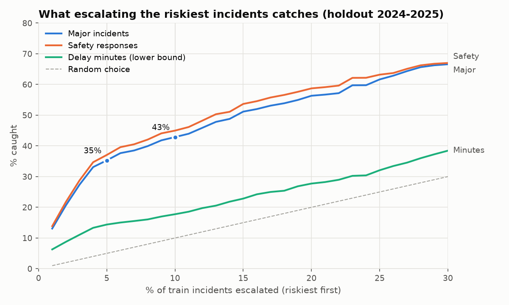
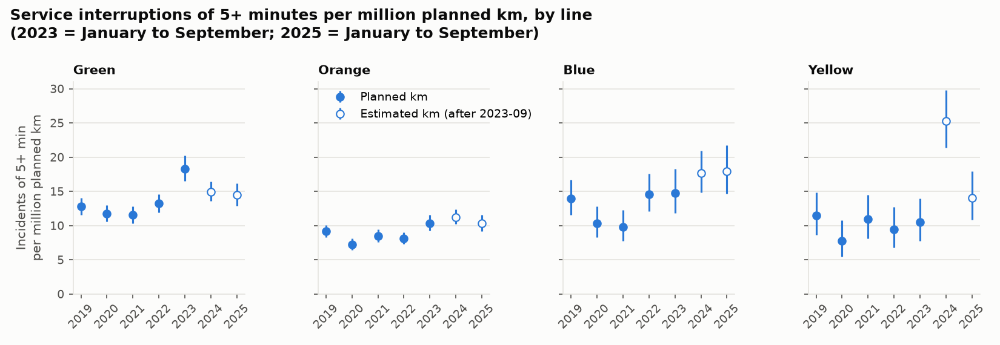

# Predicting Major STM Metro Interruptions

## Introduction

The Société de transport de Montréal (STM) wants to escalate and prioritise metro
incidents better, and is unsure whether the trends in its incident data reflect
reliability, service volume, reporting practices or classification. 

This repository builds a framework that scores each train incident, at the moment it is reported, for
the risk that it becomes a **major interruption**, and uses the same data to answer how
STM should measure reliability, prioritise action and improve what it collects.

The report and the repository are optimized for its three readers:
- VP Operations: earlier escalation
- CFO: prioritisation and a measurable burden
- Public Affairs / Safety: clarity on rare severe events. 

Those priorities set the target for the analysis: **safety first, then the longest disruptions.**

Findings and decisions have been logged in [documentation.md](documentation.md).

## Executive summary

**Goal:** Predict, from what is known when an incident is reported,
whether a train incident becomes major: a safety response (an evacuation or the metro
emergency team) or a delay of 30 minutes or more. In 2019-2023, **5.6%** of train incidents
were major, and they carried **38.7%** of all delay minutes.

**Summarised Results:**
* **Escalating the riskiest 1 incident in 10 catches about 4x what chance would.** In
  the 2021-2023 backtest it caught 38% of major incidents and 40% of safety responses.
  On the 2024-2025 holdout, which no model was trained or tuned on, it caught 43.7% of
  major incidents [40.0, 48.2] and 46.2% of safety responses, at about 9 escalations a
  week. That group also holds 73% of the evacuations of a train and its station.
* **Gradient boosting goes forward**, with logistic regression next to it as the
  explainable benchmark. The two are close; OLS, a neural net and XGBoost do no better.
  This implies that the limit is what is known at report time, not the method.
* **The priority is safety, not delay minutes.** The same 10% holds only about 16% of
  delay minutes. Known information at report time says very little about how long an
  incident lasts.
* **It is blind to customer incidents**, a quarter of major incidents, none escalated, and
  nothing recorded today separates the dangerous ones.
* **A second look after 5 minutes: promising in the backtest, not confirmed on
  2024-2025.** Most incidents are over within 5 minutes. A model retrained on the ones
  still delaying service ranked them better in the backtest, but no better than the
  report-time score on the holdout. What did hold is the filter itself: escalating the
  riskiest tenth of what is left is about 106 alerts a year instead of 463, for a
  similar share of the 30+ minute incidents (34-40% against 39-41%). Worth a live test,
  not yet a result.
* **Reliability should be measured as incidents of 5+ minutes per million planned km, by
  line.** Service volume explains little of the trends; short incidents drive the raw
  counts and are where recording changes show up. Interruptions of 5+ minutes rose in
  2023; major incidents did not.

## Data sources

We were given two files, both from the Ville de Montréal open-data portal, pulled on
2026-07-07. They live in `data/raw/`.

| File | What's in it | Covers |
|---|---|---|
| `incidents_metro_20260707.csv` | One row per incident: train or station, date and times, line, location, how long service was delayed (in buckets), the symptom, the causes, and yes/no flags for things like evacuation, emergency team, doors and the emergency brake | Jan 2019 to Sep 2025: 45,561 incidents (29,167 train, 16,394 station) |
| `km_planifie_20260707.csv` | How many train-km STM planned to run, by line and day | Jan 2019 to **Sep 2023** only |

**Limitations:**

* **There's nothing about people getting hurt.** No injury field at all. So "safety" here
  means STM had to respond: an evacuation or the metro emergency team. About half of
  those are just a broken-down train being emptied.
* **We don't know when most fields get filled in.** Causes, evacuations and end times
  are clearly entered after the fact, so we never let the model see them. For a few
  others (the door flag, the emergency brake, the run number) we honestly can't tell.
  How we dealt with that is in the modelling section.
* **Delays are published in buckets** (0-2 min, 3-4, 5-9, ..., 30+). For train incidents
  the start and end times agree with the bucket 98% of the time, so we trust the
  recorded delay as a real number of minutes.
* **The km file stops two years early** (Sep 2023), and it's what was *planned*, not what
  actually ran. After Sep 2023 we carry the last year's km forward and mark those rates
  as estimates.
* **The way STM records things changed twice.** From April 2025, about a third fewer
  short incidents show up. And in 2024, train breakdowns were much less often confirmed
  as train problems once investigated.

## Process

The process here was to start with the simplest thing, see how far it gets, and
only add something more complicated if it actually does better on the same incidents.

### 1. Exploration

Before writing any cleaning code or fitting any model, we spent four notebooks
(`code/exploration/01` to `04`) just looking at the data, to see what patterns jump out
and what's broken.

* **01, the incidents file as published.** What placeholders it uses instead of blanks,
  which columns have the wrong type, the two different clocks it mixes, spelling
  variants for lines and stations, and which fields are known when an incident is first
  reported. It ends with a to-do list for cleaning.
* **02, the km file.** Same check, plus a first look at incidents per km.
* **03, small vs big incidents.** Incidents of 30+ minutes are under 2% of all incidents
  but over a quarter of the delay minutes, and they look different (lots of fire and
  smoke). This is where we saw that a model built around the usual 5-minute cut-off
  would chase lots of small delays and miss the rare serious ones.
* **04, is the data consistent, and are there early warnings?** How often the first
  symptom matches the cause found later, what "severe" the data can actually support,
  whether location matters, whether incidents cluster, whether there's seasonality, and
  whether station incidents warn of train incidents.

### 2. Cleaning

Every cleaning rule comes from that to-do list created during exploration.

* **Placeholders.** STM writes `#`, `#N/A` or `Non affecté` instead of leaving a field
  blank. These become proper blanks, except for evacuation, where `#` actually means
  "no evacuation".
* **Dates and times.** The file counts hours past midnight as 24, 25, 26... (the service
  day), except on 60 rows that use the normal clock. We turn both into one real
  timestamp.
* **Lines and locations.** Excel had turned the line "2, 4" into a date (2 April), so we
  fixed that. The location column mixes stations, stretches between stations, whole
  lines, yards and so on, so we split it into those kinds.
* **Delay.** Every cut-off we use (5, 10, 15, 30 minutes) is the edge of a bucket, so
  "30+ minutes" is exact even though the delay is bucketed.
* **Km.** Some days had two rows for the same line; we merged them into one, then built
  a table of incidents and km by line and month.

### 3. Modelling

The following were defined before model training:

* **Target:** Whether a train incident becomes *major*: STM had to respond for
  safety, or service was down 30+ minutes.
* **Input Features:** Only what the control room knows when the
  incident comes in: the symptom, the line, the kind of location, whether it's at the end
  of a line, the door flag, the emergency brake and the time of day.
* **Exclusions:** Three fields carry a strong signal but might be filled
  in later: the run number, a location of "whole line", and the list of door numbers. If
  they're filled in after the fact, using them would be cheating, so the main model
  doesn't use them. We tested them separately.
* **Backtesting:** Train on earlier years, test on the next one, for 2021, 2022 and 2023.
  Then one final test on 2024-2025, which no model saw until the very end, with the rules
  for it written down before we ran it. All the ranges in brackets come from resampling
  whole days.
* **Scoring:** If STM escalates the riskiest 5% or 10% of incidents, how many of the
  major ones, the safety responses and the delay minutes does that catch? Safety and
  minutes are always shown side by side, never mixed into one number.

Each model only had to beat the one below it on the same incidents:

| Model (average of 2021-2023) | PR-AUC | Riskiest 10% catches |
|---|---|---|
| Guessing (everyone gets the average) | 0.057 | 10% of major incidents |
| A lookup table: symptom x line | 0.136 | 25% |
| Logistic regression | 0.221 | 38% |
| Gradient boosting | 0.230 | 38% |

Each step up to logistic regression is a clear win every year. We chose gradient
boosting on these years, before the final test: in the first setup it was ahead of
logistic regression in every year, by about 0.02 PR-AUC. After the later fixes (below)
that lead shrank to a tiny amount, within the noise. On 2024-2025 it was ahead clearly
(+0.031 PR-AUC, range 0.013 to 0.045), but that confirms the choice; it did not make
it. We kept logistic regression next to it, because it's easy to explain and you can
see exactly what the extra complexity buys.

We also ran OLS (a straight-line regression on a 0/1
outcome), a small neural net and XGBoost through the exact same tests. XGBoost and the
neural net tie gradient boosting. OLS does worse at the very top of the list: it adds
risks together, when really two risky signs together are much worse than the sum. All
five land within 0.04 PR-AUC of each other, which tells us the limit is the information
we have, not the method.

We also used three different checks on the training
years: random-forest importance, a lasso regression, and dropping each variable from
gradient boosting one at a time. They all agree that weekend and transfer station add nothing.
Those two variables were subsequently dropped to retain simplicity.

For robustness, we changed one thing at a time and reran:

* **Counting safety responses double or quadruple** changed nothing, so every incident
  counts once. Because nothing is reweighted, the model's probabilities come out right
  without any adjustment (5.6% predicted vs 5.2% actual on 2024-2025).
* **Adding back the three fields we kept out** helps a little (+0.021 PR-AUC).
* **Taking out the door flag and emergency brake** drops the catch from 38% to 30%. We
  assume both are known when the incident is reported, but the data can't prove it. 

**The final test on 2024-2025**, under rules written down before its first run:

| Model | PR-AUC | Riskiest 5%: major | Riskiest 10%: major | Riskiest 10%: safety |
|---|---|---|---|---|
| Guessing | 0.052 | 5.0% | 10.0% | 10.0% |
| Symptom x line table | 0.205 | 20.3% | 30.8% | 32.9% |
| Logistic regression | 0.287 | 33.6% | 42.1% | 44.4% |
| **Gradient boosting** | **0.318 (0.278 to 0.365)** | **35.6%** | **43.7%** | **46.2%** |



We did change a few things after first running this test: dropping the two useless
variables, and three fixes after a review (no safety weighting, no probability
adjustment, and using the recorded delay minutes). Each change was decided only on the
2019-2023 data, the test was rerun after it, and we kept the before and after numbers.
They barely moved.

### 4. Caveats & Extensions

* Right now the model checks an incident once, when it's first reported. But most
  incidents are over in under 5 minutes. So we tried checking again at the 5-minute mark,
  only on the ones that are still going. All the long ones (30+ minutes) are still in
  that group. In the backtest, a model retrained on that group ranked the long ones
  better than the report-time score in 2021 and 2022, but not in 2023. We then wrote
  down a pass/fail rule and tested it once on 2024-2025: **not confirmed** (PR-AUC
  difference -0.000, range -0.039 to +0.042). Retraining adds nothing on new years.
  What does hold is the filter: escalating the riskiest tenth of what's left is about
  106 alerts a year instead of 463, for a similar share of the long incidents. The
  price is a warning that comes 5 minutes later. It's an idea for a live test, not a
  result.
* The model is good at spotting train breakdowns and fires, and it's good at the worst
  cases, like a whole train and station being evacuated. But it can't tell which
  passenger-related incidents will turn serious. It also misses long delays where
  nobody was evacuated and the emergency team wasn't called.
* We tried predicting how many big incidents each line will have next month. Nothing
  did better than just taking that line's recent average. These monthly numbers are
  mostly luck.
* We tried a model that predicts how long each delay will last. It caught a bit more of
  the total delay time, but less than half as many of the serious incidents. So we
  stuck with serious incidents as the main goal.
* Separately, we counted incidents per kilometre of planned service, by line and by
  year. That way a busy line doesn't look worse just because it runs more trains.



### 5. Station Incidents

Station incidents (16,394 of them) never delay trains themselves. They're always in the
shortest delay bucket. We checked whether they could warn us that a train incident is
coming:

* **Day to day:** Station and train incidents look linked (correlation 0.55), but that's
  just busy lines having more of both. Once each day is compared only with the same
  line, weekday and month, it drops to 0.09.
* **Same station, right after:** Compared with the same station at the same time on
  other weeks, a station incident is followed by about one extra major train incident a
  year.
* **As a model input:** A station incident in the hour before doesn't change how often a
  train incident turns major.

We also don't know if station incidents are logged in real time. So they were left out.

## Recommendations

**1. Measuring reliability:**

* **Main measure:** Train incidents of 5+ minutes per million planned km, by line, over
  the last 12 months. It takes out how much service ran, matches STM's own 5-minute
  rule, and is the least affected by changes in how things get recorded.
* **Next to it:** Major incidents per million km for safety, and delay minutes per
  million km for the overall burden.
* **Avoid:** The total count of incidents. Four in five are under 5 minutes, and that's
  where the recording changes show up.
* **Causes:** Report them separately. The way causes were confirmed changed in 2024, so
  a count by cause mixes real problems with how they were labelled.
* **Where things stand:** 5+ minute incidents went up in 2023 and stayed up. Major
  incidents didn't. Orange is the most reliable line per km. Blue has the most major
  incidents per km, more than twice orange.

**2. Prioritising action:**

* **At report time:** Escalate the riskiest 1 in 10 incidents, about 9 a week. On
  2024-2025 that caught 44% of major incidents and 46% of safety responses.
* **Blind spots:** Passenger-related incidents and long delays with no safety response.
  A low score there doesn't mean it's safe.
* **Second check:** Promising in the backtest, not confirmed on 2024-2025. Waiting 5
  minutes still cuts alerts from about 463 to 106 a year for a similar share of long
  incidents, so try it in a live test, logging when each incident is still going.
* **Monthly forecasts:** Not worth it. A line's recent average does just as well.
* **Delay minutes:** The savings here are small, about 400 minutes a year in a middle
  case. The real case for the model is safety.

**3. Data to collect:**

| What | Why |
|---|---|
| When each field gets entered | The model can only use what's known when the incident comes in. Right now we have to assume it for the door flag and emergency brake, and without them the catch drops from 38% to 30% |
| When an evacuation or the emergency team was called | We could then measure how much warning the model actually gives |
| How many riders each incident affects | A packed train at rush hour and an empty one at 1 a.m. count the same today |
| More detail on passenger-related incidents at report time | They're a quarter of major incidents and the model can't pick out the serious ones |
| Km actually run, and planned km after Sep 2023 | Rates stop in Sep 2023, and planned is not the same as actual |
| Whether anyone was hurt | Without it, "safety" can only mean "STM responded" |
| A dated note whenever recording rules change | We could only guess at the 2024 and April 2025 changes from the data |

**4. Financial burden (CFO):**

The cost of an incident is roughly:

    delay minutes x riders delayed x value of a rider's minute  +  direct costs

The data only has the delay minutes. STM already has the other two numbers, so the
minutes saved can be turned into dollars directly. 

## Navigating the Repository

Install the packages (Python 3.13):

```bash
pip install -r requirements.txt
```

Run the whole pipeline:

```bash
python code/main.py
```

This rebuilds everything from the two raw files in about 7 minutes: the cleaned data,
every result table and every figure.

```
DS_challenge/
├── README.md              this file
├── documentation.md       full log of findings and decisions
├── data/
│   ├── raw/               the two files as published
│   └── processed/         cleaned data, rebuilt by main.py (not in git)
├── code/
│   ├── main.py            runs the whole pipeline
│   ├── config.py          file paths and constants
│   ├── exploration/       notebooks 01-08, run by hand
│   ├── cleaning/          turns the raw files into clean tables
│   ├── modeling/          target, inputs, models, backtests and final test
│   └── reporting/         reliability tables and figures
├── outputs/
│   ├── backtest/          every result table (CSV)
│   └── figures/           the figures in this README
└── tests/                 one test file per module
```

* **Notebooks:** 01-04 came before any cleaning code. 05-08 answer questions that came
  up later: delay minutes, which variables matter, the April 2025 recording change, and
  the monthly counts.
* **Tests:** `pytest` runs the 192 quick tests. `pytest -m slow` also runs all of
  `main.py` from start to finish.

## Working with Claude Code

This project was built with Claude Code, Anthropic's coding agent.

* **My role:** I set the direction and made the calls: what to predict, what the model
  is allowed to see, how to test it, and when to stop adding complexity.
* **Claude Code's role:** It wrote the code one step at a time and suggested checks,
  which I kept or dropped.
* **Testing:** Every step came with tests, and we didn't move on until they passed. They
  check the cleaning, make sure nothing known only after an incident gets into the
  model, and make sure each step hands the next one what it expects.
* **Rules first:** How we'd score models and how the final test would run were written
  down before we saw any results. When we changed something later, we decided it on
  2019-2023 only, reran everything, and kept both sets of numbers.

## Conclusion

Using only what's known when an incident is reported, the riskiest 10% of incidents
holds about 40% of the major ones and 40-46% of the safety responses. That's about four
times better than chance, and it held up on two years the model was never trained or
tuned on. Fancier models barely helped, which tells us the limit is the data, not the
method. The biggest gains from here come from better data: when each field gets
entered, more detail on passenger incidents, and how many riders each incident affects.
Next, we'd run the model and the 5-minute second check live alongside STM's control
room, where the second check still has to prove itself.
